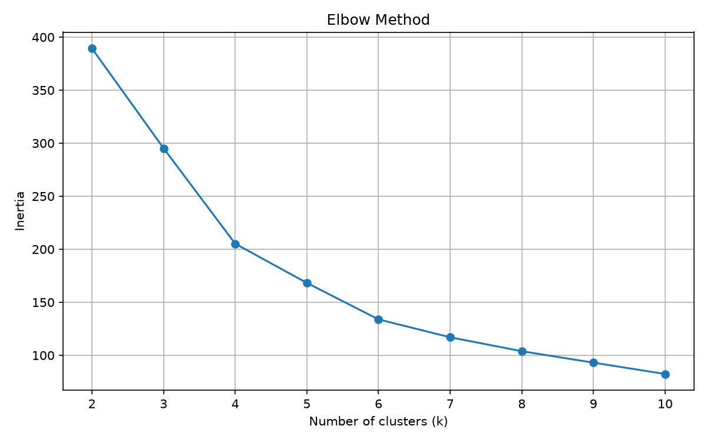
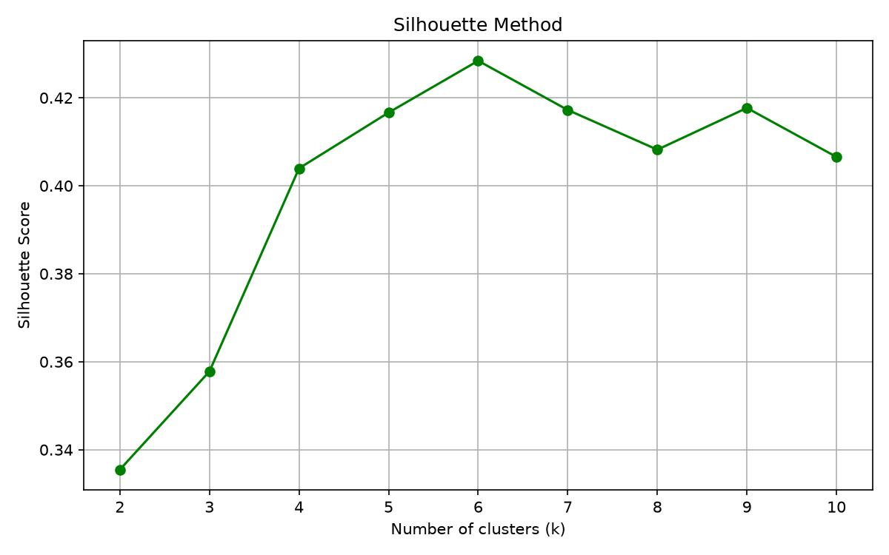
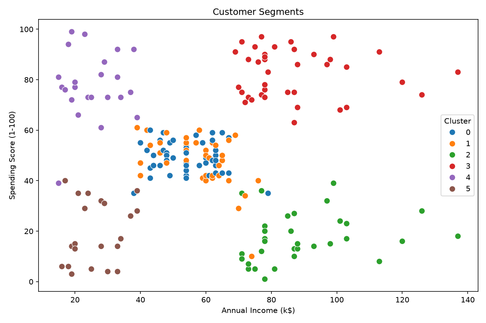
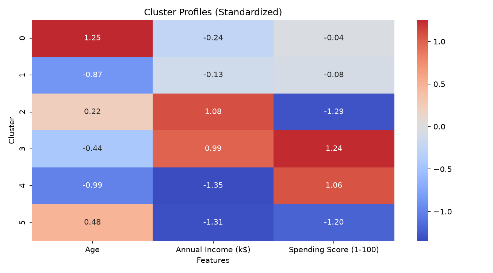

# Практическая работа №10

## Тема
Кластеризация K-Means.
Определение оптимального количества кластеров.

## Вариант
Уровень B.

## Цель
Разделить клиентов торгового центра на группы
по возрасту, доходу и покупательской активности.

## Датасет
Mall Customers Dataset.

Используемые признаки:
- Age
- Annual Income (k$)
- Spending Score (1-100)

## Использованные библиотеки
- pandas
- numpy
- matplotlib
- seaborn
- scikit-learn

## 1. Метод локтя
Проверены значения k от 2 до 10.

Наблюдение:
[Вписать, где находится возможный локоть]

## 2. Коэффициент силуэта
Для k от 2 до 10 рассчитан Silhouette Score.

Максимальный силуэт получен при k = [вписать].

## 3. Выбор количества кластеров
Выбрано k = [вписать].

Обоснование:
[Сравнить локоть, силуэт и удобство
интерпретации групп клиентов]

## 4. Профили кластеров
Средние значения признаков находятся
в results/cluster_profiles.csv.

Названия и характеристики:
- Кластер 0: [название и описание]
- Кластер 1: [название и описание]
- Остальные кластеры: [добавить по результатам]

## 5. Проверка устойчивости
Первая модель: random_state = 42.
Вторая модель: random_state = 123.

Adjusted Rand Index = [вписать].

Вывод:
[Указать, изменился ли состав кластеров]

## Общий вывод
Метод K-Means позволил разделить клиентов
на группы по сходству характеристик.

Метод локтя и коэффициент силуэта
использованы для выбора числа кластеров.

Полученные сегменты можно применять
для анализа поведения покупателей.
